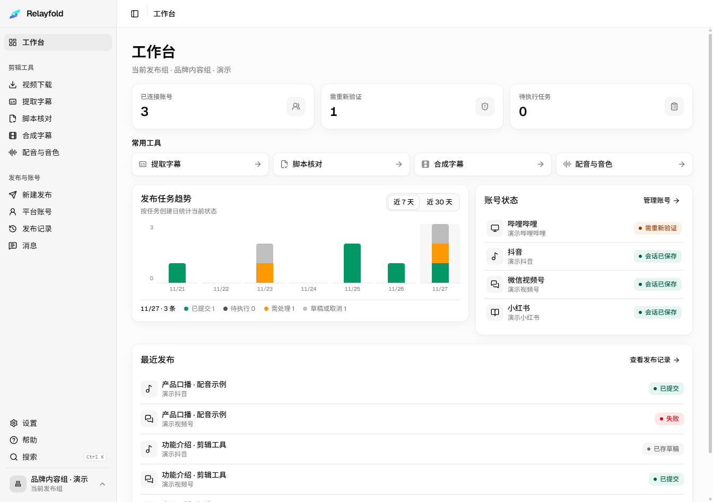
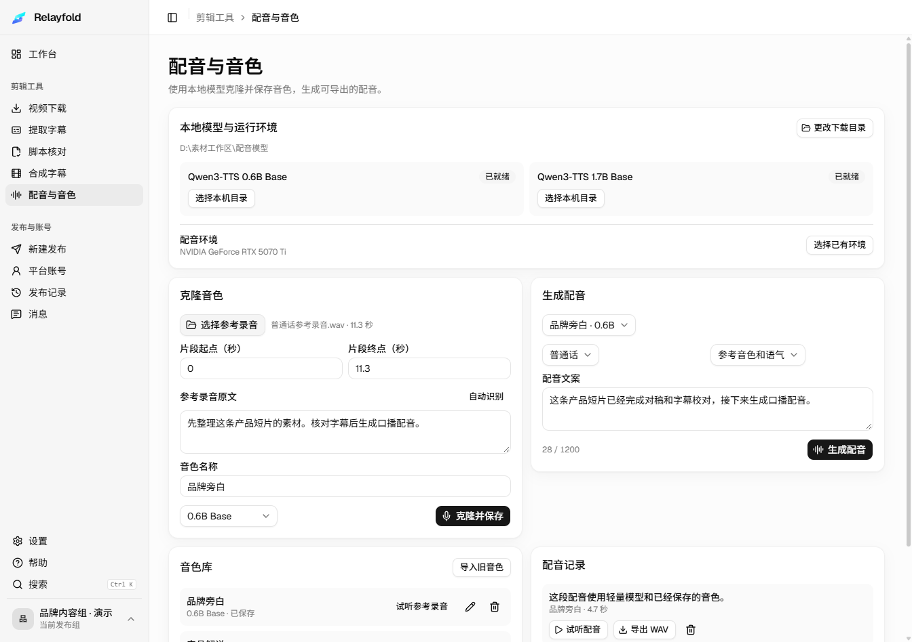
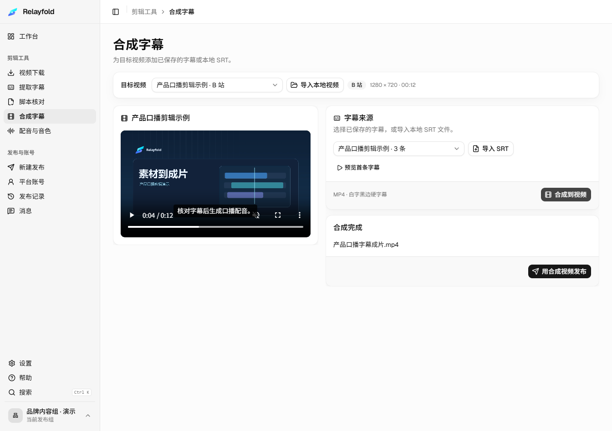

<p align="center">
  
</p>

<h1 align="center">Relayfold</h1>
<p align="center"><strong>面向剪辑师和内容团队的本地视频制作与交付工作台</strong></p>

<p align="center">
  <a href="https://github.com/YoLin02/Relayfold/tree/main"></a>
  
  
</p>

<p align="center">
  <a href="#剪辑工作流">剪辑工作流</a> ·
  <a href="#界面预览">界面预览</a> ·
  <a href="#安装与运行">安装与运行</a> ·
  <a href="#平台支持与验证">平台支持与验证</a>
</p>

Relayfold 把素材获取、字幕校对、声音制作和发布交付放进同一个 Windows 应用。下载 B 站视频或导入本地素材，提取字幕并用 Word 原稿核对，需要配音时用本地模型克隆并保存音色。制作完成后，可以导出 SRT、WAV 或烧录字幕的 MP4，也可以把成片送进多账号发布草稿。



## 剪辑工作流

| 入口 | 可完成的操作 | 输出与交接 |
| --- | --- | --- |
| **视频下载** | 解析 B 站视频链接或分享短链，选择清晰度，查看进度或重试。 | 打开本地文件夹，或将所选素材直接送去提取字幕。 |
| **提取字幕** | 导入本地视频，提取内封文字字幕或读取同名字幕文件。也可用 Whisper 从音轨识别，适用于无文字轨或烧录字幕的视频。 | 编辑时间和文本，点击台词定位预览，保存并导出 SRT。 |
| **脚本核对** | 导入 Word `.docx`，对照原稿和视频字幕。差异可以试听、标记为已核对，或跳到对应的时间轴条目修改。 | 保存修改后重新核对，继续使用当前素材及字幕版本。 |
| **配音与音色** | 按需下载 Qwen3‑TTS 0.6B 或 1.7B Base，或选用已有模型。可截取参考录音、自动识别并校对原文，克隆、保存和复用音色。 | 试听并导出 24 kHz WAV。音色库支持重命名和导入兼容的旧音色。 |
| **合成字幕** | 为所选视频加载已保存字幕或独立 SRT，预览字幕合成效果。 | 输出新的硬字幕 MP4，可继续在剪辑软件使用或带入发布草稿。 |

字幕和配音可作为独立素材交给剪辑软件。生成的 WAV 可在剪辑软件内放回音轨、对齐和混音。字幕识别、模型推理和媒体处理在本机运行，素材、音色、账号会话和任务记录保存在本机。

## 界面预览

以下为 **0.0.3** 运行界面，账号、任务和媒体均为演示数据。

| 脚本与字幕核对 | 本地配音与音色库 |
| --- | --- |
| [](docs/screenshots/word-script-review.png) | [](docs/screenshots/voice-workspace.png) |

| 字幕成片 | 群发前核对 |
| --- | --- |
| [](docs/screenshots/subtitle-synthesis.png) | [](docs/screenshots/publish-review.png) |

[视频下载](docs/screenshots/video-download.png) · [发布草稿](docs/screenshots/publish-workspace.png) · [平台账号](docs/screenshots/platform-accounts.png) · [消息与评论](docs/screenshots/xiaohongshu-comments.png)

## 工作台与发布交付

- **工作台**显示当前发布组的账号状态、待执行任务和最近发布。发布趋势支持近 7 天或 30 天，按日期查看任务状态分布。左下角的头像菜单可切换和管理发布组，切换时保留正在使用的剪辑工具、所选视频和字幕编辑。
- **发布草稿**支持视频、图文、文章。标题、正文、标签和封面可以按抖音和小红书分别调整，提交前可逐个平台核对。常规组每个平台可绑定一个账号，自定义组可绑定同一平台的多个账号。
- **任务队列**支持立即提交、定时、改期和取消。关窗后可由 Windows 托盘继续处理，定时任务要求电脑保持唤醒并联网。任务始终使用入队时选定的账号，回执、待核对结果和诊断可从发布记录查看。
- **消息与评论**提供小红书收到评论、完整评论和回复核对。抖音提供官方评论及私信入口，支持保存本地私信草稿。

## 安装与运行

**0.0.3 源码版本**适用于 Windows x64。需要 Node.js 22.12+ 和 Python 3.11+。视频与音频工具需要系统 PATH 中的 FFmpeg 和 FFprobe，网页发布需要 Google Chrome。

```powershell
git clone https://github.com/YoLin02/Relayfold.git
cd Relayfold
npm ci
python -m venv .venv
.\.venv\Scripts\python.exe -m pip install -r worker\requirements.txt
$env:ZT_PYTHON = (Resolve-Path '.\.venv\Scripts\python.exe').Path
npm run build
npm start
```

**本地配音环境**面向 Windows x64 和 NVIDIA CUDA。可在「剪辑工具 → 配音与音色」按需安装，也可选用已有 Qwen3‑TTS 环境的 `python.exe`。自动安装需要至少 12 GiB 可用空间，0.6B 和 1.7B 模型分别约 2.52 GB 和 4.54 GB，另计。模型下载支持文件校验和续传。参考录音可选取 3 至 30 秒的单人片段。

**已有便携包**为早期的 0.0.2 预览版。下载后完整解压，再运行 `Relayfold.exe`。上方界面对应 0.0.3 源码。 [下载 0.0.2 Windows x64 便携预览包](https://erp.gzsenhan.com:18443/relayfold/Relayfold-0.0.2-Windows-x64-20261127.zip) · [SHA-256 校验文件](https://erp.gzsenhan.com:18443/relayfold/Relayfold-0.0.2-Windows-x64-20261127.zip.sha256) · [历史 GitHub Releases](https://github.com/YoLin02/Relayfold/releases)

## 平台支持与验证

视频下载入口支持 B 站。发布适配的验证按平台和内容类型记录，平台回执表示确认收稿，公开状态以平台审核为准。

| 内容 | 平台 | 验证范围 |
| --- | --- | --- |
| 视频、图文 | 抖音、小红书 | 视频已验证真实提交，图文已验证模拟表单。 |
| 视频 | 快手、微信视频号、哔哩哔哩、TikTok、YouTube、Facebook、Instagram、X / Twitter | 已接入，待真实提交验证。 |
| 文章 | 知乎、头条号、CSDN、简书、搜狐号、百家号、网易号、Reddit、Medium、LinkedIn、Blogger、Quora、DEV Community | 已接入，待真实提交验证。 |
| 文章草稿 | 微信公众号 | 已接入，任务写入草稿，最终群发在公众号后台完成。 |

小红书的笔记同步、评论读取和回复提交有真实验证记录。桌面隔离测试覆盖了发送期间切组、原账号隔离和待核对处理。

## 开发与测试

界面使用 Electron、React、TypeScript 和 shadcn/ui。本地 Worker 使用 Python 和 SQLite，媒体处理基于 yt-dlp、FFmpeg、FFprobe、whisper.cpp 和 Qwen3‑TTS，网页发布通过 Playwright 或 Patchright 运行。浏览器会话按绑定账号隔离，支持 Windows DPAPI 登录态备份。依赖来源见 [THIRD_PARTY.md](THIRD_PARTY.md)。

开发和演示时可将 `ZT_PUBLISHER_DATA_DIR` 指向独立目录，用单独的素材、浏览器会话和任务记录。

```powershell
npm run build
& $env:ZT_PYTHON -B -m unittest discover -s tests -p '*_test.py'
npm run test:e2e
```
