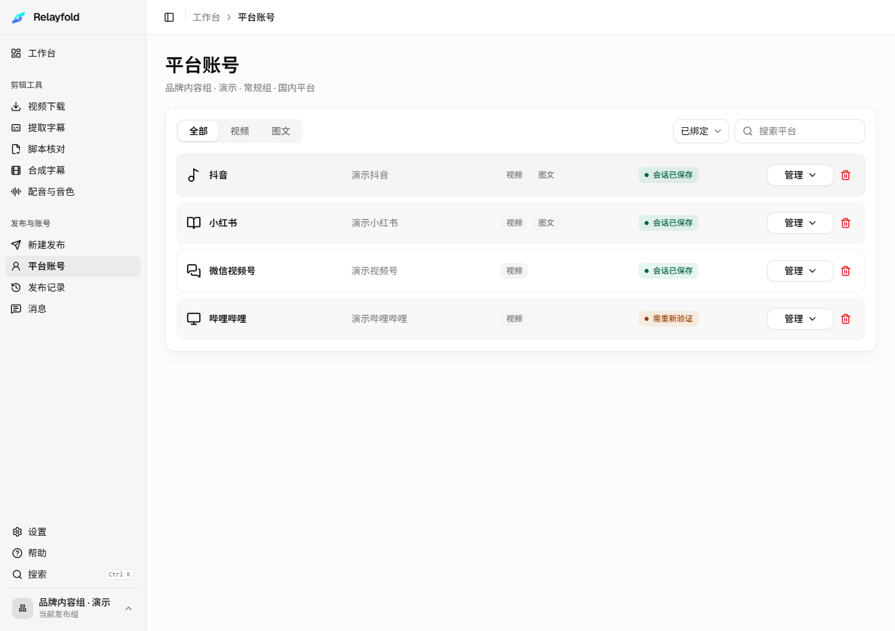
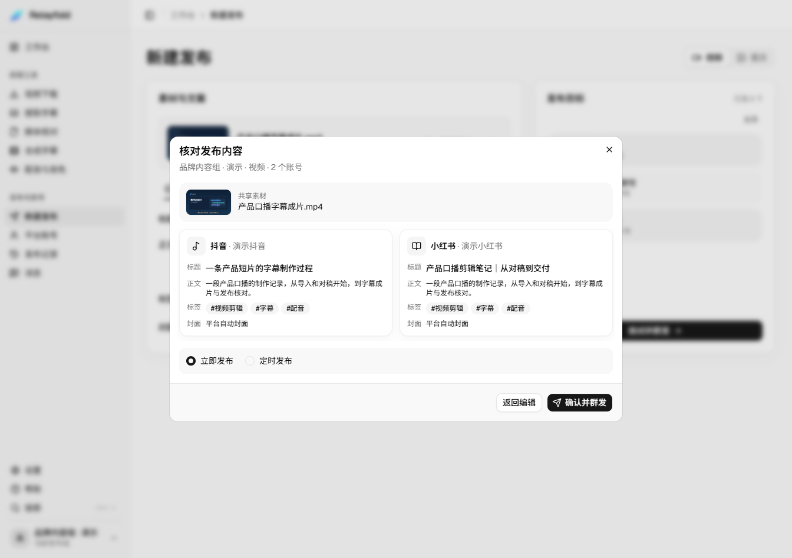
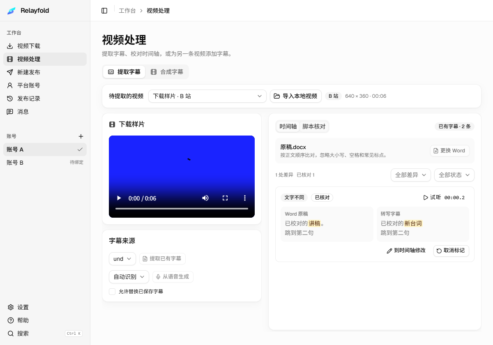
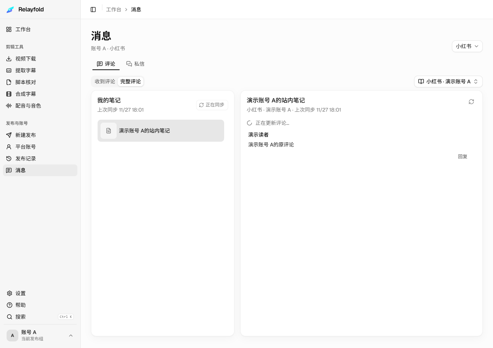

<p align="center">
  
</p>

<h1 align="center">Relayfold</h1>
<p align="center"><strong>视频下载、字幕处理与抖音、小红书、微信视频号等平台的一键群发</strong></p>

<p align="center">
  <a href="https://github.com/YoLin02/Relayfold/tree/preview-20261127"></a>
  <a href="https://erp.gzsenhan.com:18443/relayfold/Relayfold-0.0.2-Windows-x64-20261127.zip"></a>
  
  
  <a href="#平台支持与验证"></a>
  <a href="#平台支持与验证"></a>
  <a href="#视频处理与字幕"></a>
</p>

<p align="center">
  <a href="#界面预览">界面预览</a> ·
  <a href="#视频处理与字幕">视频处理与字幕</a> ·
  <a href="#消息与评论">消息与评论</a> ·
  <a href="#平台支持与验证">平台支持与验证</a> ·
  <a href="#从源码启动">从源码启动</a> ·
  <a href="#技术栈">技术栈</a>
</p>

Relayfold 是一款面向剪辑师和内容运营者的 Windows 本地工具。它可以下载 B 站视频、提取和校对字幕、用 Word 原稿对稿，再把合成后的成片带入发布页。选一次素材即可为抖音、小红书、微信视频号、哔哩哔哩等目标准备视频、图文或文章，按平台调整文案和封面后统一核对。账号会话、素材记录、核对进度和发布队列保存在本机。

**[下载 Windows x64 便携预览版](https://erp.gzsenhan.com:18443/relayfold/Relayfold-0.0.2-Windows-x64-20261127.zip)**（2026-11-27，约 454 MB）。完整解压后双击 `Relayfold.exe`。网页发布需要 Google Chrome，视频下载和处理需要将 FFmpeg、FFprobe 加入 PATH。语音识别模型随便携包提供。 [SHA-256 校验文件](https://erp.gzsenhan.com:18443/relayfold/Relayfold-0.0.2-Windows-x64-20261127.zip.sha256) · [历史 GitHub Releases](https://github.com/YoLin02/Relayfold/releases)

## 界面预览

下面是 Relayfold 的实机截图，账号、素材和评论均为演示数据。


| 平台账号 | 群发前核对 |
| --- | --- |
| [](docs/screenshots/platform-accounts.png) | [](docs/screenshots/publish-review.png) |



## 主要功能

- **多账号与发布组**。常规组每个平台可绑定一个账号。自定义组可添加同一平台的多个账号，各自保存登录态。入队后切组，任务继续使用创建时选定的账号。
- **视频、图文和文章群发**。抖音和小红书可分别覆盖通用标题、正文、标签和封面。确认页逐一核对目标账号和最终内容。
- **定时发布与托盘常驻**。预约支持改期和取消。关窗后继续从托盘运行，电脑须保持唤醒并联网。预约时间是开始处理的时间，作品公开时间取决于上传和审核。
- **发布记录与诊断**。按日期筛选、查看回执或诊断、删除本地记录。平台确认收稿时显示「已提交」，提交结果不明确时显示「待核对」。
- **小红书评论**。同步账号近期笔记，逐篇查看评论并以原账号回复。
- **工作台设置**。可切换国内或国外平台、主题色，使用 `Ctrl+K` 搜索账号、发布组和页面。

## 视频处理与字幕

| 入口 | 操作与输出 |
| --- | --- |
| 视频下载 | 粘贴 B 站视频链接或分享短链，选择清晰度。下载完成后可以打开文件夹，或将素材送到「视频处理」。 |
| 提取字幕 | 选下载好的素材或导入本地视频。可以提取内封文字字幕、读取同名字幕文件，或用本地 Whisper 从音轨转写。点时间轴中的台词即可跳转，播放时画面会显示字幕。 |
| Word 脚本核对 | 在「视频处理 → 提取字幕 → 脚本核对」导入 `.docx`。没有已保存的字幕时，优先提取内封文字字幕，其次读取同名文件。原稿与转写按连续文本对齐，差异可试听、跳到时间轴修改或标记已核对。保存后重新比较。 |
| 合成字幕 | 分别选择目标视频和字幕。可使用已保存的字幕或导入独立 SRT，预览后生成新的硬字幕 MP4，再带入当前账号组的发布草稿。 |

B 站下载、Word 差异定位、已有字幕优先提取，以及「独立视频 + SRT → 合成 → 发布草稿」均已验收。下载平台目前为 B 站，微博、抖音等平台处于扩展验证阶段。

## 消息与评论

**已使用真实小红书账号验证笔记同步、评论读取和回复提交。** 实测可以读到小红书账号主页上没有 Relayfold 发布记录的笔记，回复已获得平台确认。发送途中切组使用隔离桌面测试验收，仍由原绑定账号回复原评论。



1. 打开「消息」，切换到小红书账号的评论。
2. 可在「收到评论」中查看单条新留言与追回复，或在「完整评论」中打开自己的笔记查看评论。
3. 核对目标评论、发送账号和回复正文后，再确认回复。

两栏的头部与账号操作区固定，笔记和评论列表各自滚动。设置中可管理评论提醒和本地缓存。抖音评论、私信提供官方页面入口，私信草稿可在本地准备。

## 平台支持与验证

下表列出 **24 个平台**。真实验证按内容类型记录，平台回执表示确认提交，公开状态以平台审核为准。

| 平台 | 内容 | 验证 |
| --- | --- | --- |
| 抖音 | 视频、图文 | **视频 · 真实提交已验证**；图文 · 模拟表单已验证 |
| 小红书 | 视频、图文 | **视频 · 真实提交已验证**；图文 · 模拟表单已验证 |
| 快手 | 视频 | 已接入 · 待真实验证 |
| 微信视频号 | 视频 | 已接入 · 待真实验证 |
| 哔哩哔哩 | 视频 | 已接入 · 待真实验证 |
| 知乎 | 文章 | 已接入 · 待真实验证 |
| 头条号 | 文章 | 已接入 · 待真实验证 |
| CSDN | 文章 | 已接入 · 待真实验证 |
| 简书 | 文章 | 已接入 · 待真实验证 |
| 搜狐号 | 文章 | 已接入 · 待真实验证 |
| 微信公众号 | 文章草稿 | 已接入 · 待真实验证 |
| 百家号 | 文章 | 已接入 · 待真实验证 |
| 网易号 | 文章 | 已接入 · 待真实验证 |
| TikTok | 视频 | 已接入 · 待真实验证 |
| YouTube | 视频 | 已接入 · 待真实验证 |
| Facebook | 视频 | 已接入 · 待真实验证 |
| Instagram | 视频 | 已接入 · 待真实验证 |
| X / Twitter | 视频 | 已接入 · 待真实验证 |
| Reddit | 文章 | 已接入 · 待真实验证 |
| Medium | 文章 | 已接入 · 待真实验证 |
| LinkedIn | 文章 | 已接入 · 待真实验证 |
| Blogger | 文章 | 已接入 · 待真实验证 |
| Quora | 文章 | 已接入 · 待真实验证 |
| DEV Community | 文章 | 已接入 · 待真实验证 |

微信公众号任务写入草稿，最终群发在公众号后台完成。

## 从源码启动

需要 Windows x64、Node.js 22.12+ 和 Python 3.11+。网页发布需要 Google Chrome，视频功能需要 FFmpeg 与 FFprobe。

```powershell
git clone https://github.com/YoLin02/Relayfold.git
cd Relayfold
npm ci
python -m venv .venv
.\.venv\Scripts\python.exe -m pip install -r worker\requirements.txt
$env:ZT_PYTHON = (Resolve-Path '.\.venv\Scripts\python.exe').Path
npm run build
npm start
```

开发时可将 `ZT_PUBLISHER_DATA_DIR` 指向独立目录，隔离浏览器会话与测试发布记录。Windows x64 打包版可通过本机环境变量 `RELAYFOLD_UPDATE_SSH_HOST`、`RELAYFOLD_UPDATE_SSH_DIRECTORY` 和 `RELAYFOLD_UPDATE_PUBLIC_KEY` 启用签名更新。

运行本地测试

```powershell
& $env:ZT_PYTHON -B -m unittest discover -s tests -p '*_test.py'
npm run test:e2e
```

## 技术栈

| 模块 | 实现 |
| --- | --- |
| `electron/` | Electron、IPC、Windows 托盘和本地 Worker 管理 |
| `src/` | React 19、TypeScript、Vite、Tailwind CSS v4、shadcn/ui v4、Radix UI、Lucide |
| `worker/` | Python、Playwright、Patchright 1.64.4，按平台封装网页流程或 API |
| 视频与字幕 | yt-dlp、FFmpeg、FFprobe、whisper.cpp、Silero VAD、WordprocessingML 与 Python 文本对齐 |
| 本地数据 | SQLite 记录发布组、任务、回执、素材和脚本核对进度。浏览器会话按绑定账号隔离，登录态备份使用 Windows DPAPI |

## 规划

- 扩展视频下载平台，分别验证公开分享链接、清晰度选择和完整下载。
- 针对抖音、微博等平台按样片记录可用范围，逐站验收后添加到下载入口。
