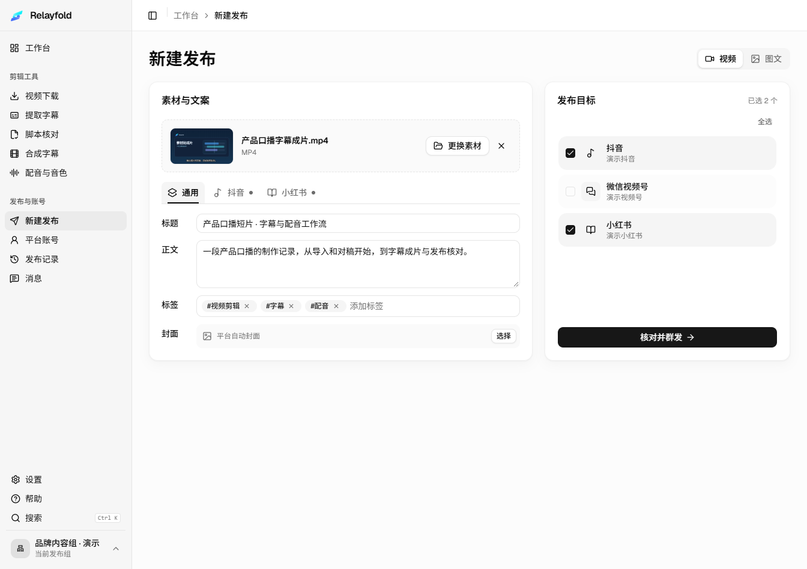

<p align="center">
  
</p>

<h1 align="center">Relayfold</h1>
<p align="center"><strong>抖音、小红书、视频号等平台的一键群发工作台</strong></p>

<p align="center">
  <a href="https://github.com/YoLin02/Relayfold/releases/tag/v0.0.2"></a>
  <a href="https://github.com/YoLin02/Relayfold/releases/download/v0.0.2/Relayfold-v0.0.2-Windows-x64.zip"></a>
  
  
  <a href="#平台支持与验证"></a>
  <a href="#平台支持与验证"></a>
  <a href="#小红书评论"></a>
</p>

<p align="center">
  <a href="#界面预览">界面预览</a> ·
  <a href="#小红书评论">小红书评论</a> ·
  <a href="#平台支持与验证">平台支持与验证</a> ·
  <a href="#从源码启动">从源码启动</a> ·
  <a href="#技术栈">技术栈</a>
</p>

Relayfold 是一款 Windows 本地发布工具，支持把视频、图文和文章一键群发到抖音、小红书、微信视频号、哔哩哔哩等平台。选一次素材，勾选多个平台账号，按需修改各平台的文案和封面，最后统一核对。账号会话、发布队列和历史保存在本机。

**[下载 Windows x64 便携版](https://github.com/YoLin02/Relayfold/releases/download/v0.0.2/Relayfold-v0.0.2-Windows-x64.zip)**。完整解压后双击 `Relayfold.exe`。网页平台需要本机安装 Google Chrome。

## 界面预览

下面是 Relayfold 的实机截图，账号、素材和评论均为演示数据。



| 平台账号 | 群发前核对 |
| --- | --- |
| [](docs/screenshots/platform-accounts.png) | [](docs/screenshots/publish-review.png) |

## 主要功能

- **多账号与发布组**。常规组每个平台可绑定一个账号。自定义组可添加同一平台的多个账号，各自保存登录态。入队后切组，任务继续使用创建时选定的账号。
- **视频、图文和文章群发**。抖音和小红书可分别覆盖通用标题、正文、标签和封面。确认页逐一核对目标账号和最终内容。
- **定时发布与托盘常驻**。预约支持改期和取消。关窗后继续从托盘运行，电脑须保持唤醒并联网。预约时间是开始处理的时间，作品公开时间取决于上传和审核。
- **发布记录与诊断**。按日期筛选、查看回执或诊断、删除本地记录。平台确认收稿时显示「已提交」，提交结果不明确时显示「待核对」。
- **小红书评论**。同步账号近期笔记，逐篇查看评论并以原账号回复。
- **工作台设置**。可切换国内或国外平台、主题色，使用 `Ctrl+K` 搜索账号、发布组和页面。

## 小红书评论

**已使用真实小红书账号验证笔记同步、评论读取和回复提交。** 实测可以读到小红书账号主页上没有 Relayfold 发布记录的笔记，回复已获得平台确认。发送途中切组使用隔离桌面测试验收，仍由原绑定账号回复原评论。


1. 打开「评论」，选定已绑定的小红书账号，点击「同步笔记」。
2. 在「我的笔记」点开一篇，右侧加载该笔记的首批一级评论。
3. 点某条评论的「回复」，核对发送账号、原评论和回复正文后，再点「确认发送」。

两栏的头部与账号操作区固定，笔记和评论列表各自滚动。平台确认后显示「已回复」，提交结果不明确时可到原笔记核对。

## 平台支持与验证

下表列出 **24 个平台**。真实验证按内容类型记录，平台回执表示确认提交，公开状态以平台审核为准。

| 平台 | 内容 | 验证 |
| --- | --- | --- |
| 抖音 | 视频、图文 | **视频 · 真实提交已验证**；图文 · 模拟表单已验证 |
| 小红书 | 视频、图文 | **视频 · 真实提交已验证**；图文 · 模拟表单已验证 |
| 快手 | 视频 | 已接入 · 待真实验证 |
| 微信视频号 | 视频 | 已接入 · 待真实验证 |
| 哔哩哔哩 | 视频 | 已接入 · 待真实验证 |
| 知乎 | 文章 | 已接入 · 待真实验证 |
| 头条号 | 文章 | 已接入 · 待真实验证 |
| CSDN | 文章 | 已接入 · 待真实验证 |
| 简书 | 文章 | 已接入 · 待真实验证 |
| 搜狐号 | 文章 | 已接入 · 待真实验证 |
| 微信公众号 | 文章草稿 | 已接入 · 待真实验证 |
| 百家号 | 文章 | 已接入 · 待真实验证 |
| 网易号 | 文章 | 已接入 · 待真实验证 |
| TikTok | 视频 | 已接入 · 待真实验证 |
| YouTube | 视频 | 已接入 · 待真实验证 |
| Facebook | 视频 | 已接入 · 待真实验证 |
| Instagram | 视频 | 已接入 · 待真实验证 |
| X / Twitter | 视频 | 已接入 · 待真实验证 |
| Reddit | 文章 | 已接入 · 待真实验证 |
| Medium | 文章 | 已接入 · 待真实验证 |
| LinkedIn | 文章 | 已接入 · 待真实验证 |
| Blogger | 文章 | 已接入 · 待真实验证 |
| Quora | 文章 | 已接入 · 待真实验证 |
| DEV Community | 文章 | 已接入 · 待真实验证 |

微信公众号任务写入草稿，最终群发在公众号后台完成。

## 从源码启动

需要 Windows x64、Node.js 22.12+、Python 3.11+ 和 Google Chrome。

```powershell
git clone https://github.com/YoLin02/Relayfold.git
cd Relayfold
npm ci
python -m venv .venv
.\.venv\Scripts\python.exe -m pip install -r worker\requirements.txt
$env:ZT_PYTHON = (Resolve-Path '.\.venv\Scripts\python.exe').Path
npm run build
npm start
```

开发时可将 `ZT_PUBLISHER_DATA_DIR` 指向独立目录，隔离浏览器会话与测试发布记录。Windows x64 打包版可通过本机环境变量 `RELAYFOLD_UPDATE_SSH_HOST`、`RELAYFOLD_UPDATE_SSH_DIRECTORY` 和 `RELAYFOLD_UPDATE_PUBLIC_KEY` 启用签名更新。

运行本地测试

```powershell
& $env:ZT_PYTHON -B -m unittest discover -s tests -p '*_test.py'
npm run test:e2e
```

## 技术栈

| 模块 | 实现 |
| --- | --- |
| `electron/` | Electron、IPC、Windows 托盘和本地 Worker 管理 |
| `src/` | React 19、TypeScript、Vite、Tailwind CSS v4、shadcn/ui v4、Radix UI、Lucide |
| `worker/` | Python、Playwright、Patchright 1.64.4，按平台封装网页流程或 API |
| 本地数据 | SQLite 记录发布组、任务和回执。浏览器会话按绑定账号隔离，登录态备份使用 Windows DPAPI |

## 规划

评论页已支持小红书。跨平台评论收件箱仍在规划中。
